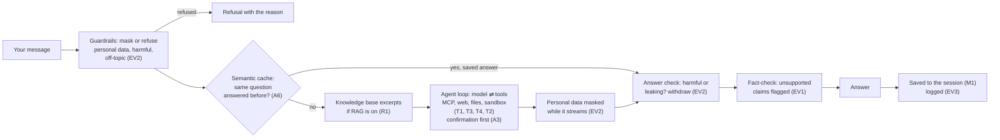

# Sensai

*Team project (4 members) at Epitech Barcelona, Sep–Nov 2026.*

A private assistant for **a developer working alone on a long-term project**: it runs on a local model through [Ollama](https://ollama.com), so the code and data of the project stay on the laptop. It remembers sessions and your profile, answers from your project's documents, calls tools and MCP servers, asks before risky actions, runs the code it writes in a sandbox, answers in JSON on demand, keeps personal data away from the model with guardrails, and flags the claims nothing supports. The full scenario is in the [use case](docs/use_case.md).

| Document | What's in it |
|---|---|
| [docs/commands.md](docs/commands.md) | Every option, command and setting, and how to turn each feature off |
| [docs/features.md](docs/features.md) | How each feature works, its settings, the choices made and its limits |
| [docs/demo.md](docs/demo.md) | The demo: one scenario, step by step, with real output |
| [docs/tests.md](docs/tests.md) | Evaluation scripts and their results |
| [docs/use_case.md](docs/use_case.md), [docs/user_stories.md](docs/user_stories.md) | Who it is for, and what each feature must do |
| [docs/architecture.md](docs/architecture.md) | The modules and what each one does |

## Requirements

| Tool | Version | Needed for |
|---|---|---|
| Python | 3.10 or higher | Everything |
| Ollama | any recent version | Running the model |
| ~6 GB free disk and 8 GB RAM | | The default model, `qwen3:8b` |
| Node.js (`npx`) | optional | The `filesystem` MCP server |
| uv (`uvx`) | optional | The `time` MCP server |
| Docker | optional | Isolating the code `run_python` runs ([Sandboxed code execution](docs/features.md#t2-sandboxed-code-execution)) |

If an optional tool is missing, the chat still works: that MCP server is skipped and the reason is written to `mcp.log`.

## Installation

Clone the repository and enter it:

```bash
git clone https://github.com/AchiQuelloVero/sensai.git
cd sensai
```

Create a Python environment and install the dependencies (one-time):

```bash
python3 -m venv .venv
source .venv/bin/activate
pip install -r requirements.txt
```

Next time, only activate the environment:

```bash
source .venv/bin/activate
```

## Ollama

Install Ollama (one-time):

```bash
# macOS
brew install ollama            # or download the app from https://ollama.com/download

# Linux
curl -fsSL https://ollama.com/install.sh | sh
```

Start it and leave it running in a separate terminal (on macOS, opening the Ollama app does the same):

```bash
ollama serve
```

> `Error: listen tcp 127.0.0.1:11434: bind: address already in use` means Ollama is already running. This is fine.

Check that it answers:

```bash
curl http://localhost:11434
# Ollama is running
```

Download the two models Sensai uses (one-time, about 5.5 GB) and check they are listed:

```bash
ollama pull qwen3:8b            # the chat model, also used for the checks
ollama pull nomic-embed-text    # embeddings for the knowledge bases and the semantic cache
ollama list
```

The chat model must support tool calling. Check a model with `ollama show <model>`: `tools` must appear under Capabilities. `gemma3:4b`, for example, does not, but can still be used by the test scripts ([Tests](docs/tests.md)).

### Context window (`num_ctx`)

Ollama only reads the last `num_ctx` tokens of a conversation. Its default is 4,096, and Sensai's system prompt with the tool list already takes about 4,000, so from the second message on Ollama would silently drop the oldest messages. Sensai sends `num_ctx` (default `16384`, in `config.json`) with every call to Ollama: the chat and the guardrail, cache and hallucination checks. They all use the same value, otherwise Ollama reloads the model each time it changes.

`qwen3:8b` accepts up to 40,960. Lower `num_ctx` if Ollama fails with out-of-memory or `ollama ps` shows CPU; raise it for long chats or big tool results if you have the memory. The change applies on the next start.

OpenRouter models ignore `num_ctx`: their window is read from OpenRouter's model list (`context_length`).

### Optional: cloud models with OpenRouter

Sensai runs on Ollama by default. To chat with a stronger model, it can also use [OpenRouter](https://openrouter.ai), which offers free models.

1. Create a key at https://openrouter.ai/settings/keys (a credit limit of 0 is enough for free models).
2. Run `cp .env.example .env` and put the key after `OPENROUTER_API_KEY=`. `.env` is git-ignored.
3. Pick a model whose name starts with `openrouter/`: in the web UI's Settings (the list comes from `openrouter_models` in `config.json`), or with `python3 sensai.py -m openrouter/nvidia/nemotron-3-ultra-550b-a55b:free`. The model must support tool calling.

Only the chat goes to OpenRouter. The guardrail, cache and hallucination checks always run on a local Ollama model, `check_model` in `config.json` (default `qwen3:8b`). These checks read the raw message, so with guardrails on it never leaves the machine: only the checked message, with personal data already masked, is sent.

Free models are rate-limited: `HTTP 429` means wait a minute. Some only run if you allow prompt logging in OpenRouter's privacy settings (error "No endpoints found matching your data policy").

## Run

```bash
python3 sensai.py        # the chat in the terminal
python3 app.py           # the same chat in the browser, at http://localhost:8000
```

Useful options: `-m <model>` to pick the model, `-r <id>` to continue a saved chat, `--persona <name>`. In the chat, `/help` (web UI) or [docs/commands.md](docs/commands.md) lists every command.

## Features

| Feature | What it does | Try it |
|---|---|---|
| [B1] Chat | Streams answers from a local model, keeps the conversation, explains errors instead of crashing | `python3 sensai.py` |
| [M1] Sessions and profile | Saves every chat, continues it later, knows your name and preferences | `python3 sensai.py -r <id>`, Sidebar → Profile |
| [T1] Tools and MCP | Calls built-in tools and MCP servers (files, time, web, Blender); its web tools are its own MCP server | "What time is it in Tokyo?" |
| [T3] Web search | Searches the web and reads pages for recent information | "What changed in the latest Python release?" |
| [A3] Confirmations | Asks before a tool that changes something, shows the exact call | "Create the file test/todo.txt with three tasks" |
| [T2] Code sandbox | Runs the Python it writes in a Docker container, sees the error and fixes it | "Use run_python to compute 2**100" |
| [T4] File access | Reads and writes only inside `safe_test/`, per-path rules | `/permissions set notes write` |
| [R1] Knowledge bases | Answers from your documents with sources; several knowledge bases, each with its own embedding model | `/rag on`, then ask about a document in `knowledge/` |
| [T5] Structured output | Answers as JSON matching a schema, retries when it doesn't | `/json bug_report The export button crashes the app` |
| [EV2] Guardrails | Masks or refuses personal data, refuses harmful or off-topic messages, withdraws unsafe answers | "My card is 4111 1111 1111 1111" |
| [A5] Personas | Switches who answers (general assistant, code reviewer, tutor) without losing the chat | `/persona vera` |
| [A6] Semantic cache | Answers a question asked again in other words in about a second | `/cache on`, ask a question twice in different words |
| [EV1] Fact-check | Flags claims in the answer that nothing in the chat, tools or documents supports | Ask about a made-up library |
| [A4] Prompt versioning | Versions the system prompt, compares two versions, rolls back | `/prompt versions` |
| [X2] Branching | Edits a past message into a new branch, stops an answer midway | `/edit 2 <new text>`, Ctrl-C |
| [EV3] Logging and stats | Logs every call, tool decision and check; shows latency, errors and the rest | `/stats` |
| [X3] Export and share | Exports a chat to JSON, Markdown or PDF, or shares a read-only link | `python3 sensai.py --export <id> --format pdf` |
| [X1] Web UI | The same assistant in the browser, with panels for every setting | `python3 app.py` |

Each feature can be turned off without breaking the others: see [Turning a feature off](docs/commands.md#turning-a-feature-off).

## How a message goes through Sensai



Every step around the agent loop can be switched off on its own; with all of them off, a message goes straight to the model and back. A saved answer from the cache still goes through the answer check, but not through the fact-check: it was checked when it was first written. The fact-check runs in the terminal and in the web UI (Settings → Fact-check: on/off, confidence threshold, action). The modules behind each step are listed in [docs/architecture.md](docs/architecture.md).

## Comparing versions of the system

`evals/eval_hallucination.py` answers the 18 questions of `evals/hallucination_cases.json` (known answers, no answer in the evidence, made-up facts) with each chat model and each saved version of `system_prompt.txt`, checks every answer, and prints a score per kind and overall. A question passes when the answer is right and nothing is flagged (known), or when the assistant says it doesn't know or the check flags the invented claims (the others).

```bash
python3 -m evals.eval_hallucination -m qwen3:8b openrouter/<model> -p 1 2 -o report.md
```

`-m` takes local and `openrouter/` models (the judge stays local, see above), `-p` takes versions from `/prompt versions`, `-o` writes the table to a file. A full run takes several minutes per question on a CPU. Paste the table of your run here:

| model | prompt | known | no_answer | fake | score | avg time |
|---|---|---|---|---|---|---|
| _run the command above_ | | | | | | |

## Troubleshooting

| Error | Fix |
|---|---|
| `cannot reach Ollama at http://localhost:11434` | Start it with `ollama serve` (check with `ss -ltnp \| grep 11434`) |
| `model '...' is not installed` | `ollama pull <model>` |
| `Ollama returned HTTP 500` | Often out of memory: try a smaller model |
| `session '...' not found` | Check the id with `/sessions` or `ls sessions/` |
| `Ollama took too long to respond` | The first request loads the model and can be slow on CPU: retry |
| `ModuleNotFoundError: No module named 'jsonschema'` | `pip install -r requirements.txt` |
| `no valid JSON after 3 attempts` | The model could not follow the schema: simplify it, add `description` hints, or try a bigger model |
| `persona '...' not found` | `/persona` lists the available ones; use the file name without `.json` |
| `invalid guardrails config ...` | The message says which field is wrong in `guardrails/config/guardrails.json` |
| `invalid hallucination config ...` | The message says which field is wrong in `hallucination/config/hallucination.json` |
| `(answer not checked: ...)` | The judge failed (Ollama down, or no valid JSON); the answer is kept unchecked. A smaller `judge_model` is faster but less accurate |
| `Sorry, I can't help with that request. (check_failed)` | The safety check could not run (usually Ollama is down), so the message was refused to be safe |
